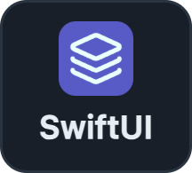
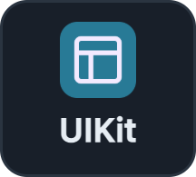
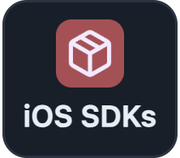
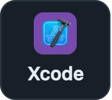
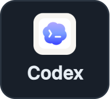
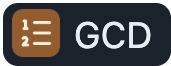
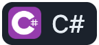

<picture>
  <source media="(max-width: 580px)" srcset="https://raw.githubusercontent.com/Kleshny77/Kleshny77/main/assets/cover/moscow-sunset-mobile.png">
  
</picture>

  
  
  
  
  
  
  
  

<strong>Full stack</strong> · 68 skills &amp; tools

**iOS development**

  
  
  
  
  
  
  
  

**Concurrency, networking & storage**

  
  
  
  
  
  
  
  
  

**SDKs & architecture**

  
  
  
  
  
  
  
  

**Build tooling & CI/CD**

  
  
  
  
  
  
  
  

**Testing & performance**

  
  
  
  
  
  
  
  

**AI-assisted development**

  
  
  
  
  
  
  
  
  

**Languages & frameworks**

  
  
  
  
  
  
  
  
  
  
  

**Developer tools**

  
  
  
  
  
  
  

