### Artem Samsonov

iOS Engineer · Apps, SDKs and build tooling

#### iOS development

  
  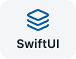
  
  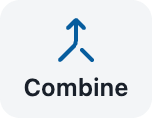
  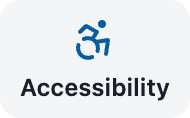
  
  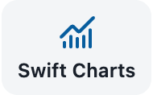
  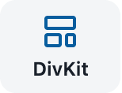

Backend-driven UI with DivKit.

#### Concurrency, networking & storage

  
  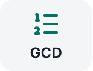
  
  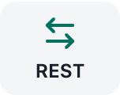
  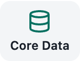
  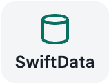
  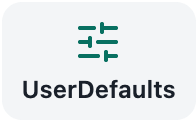
  
  

Swift 6 strict concurrency, async/await, actors and Sendable.

#### SDKs & architecture

  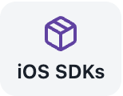
  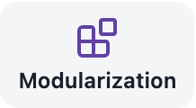
  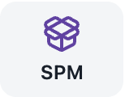
  
  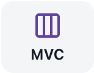
  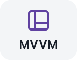
  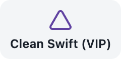
  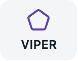

Design patterns, dependency injection, SOLID and object-oriented design.

#### Build tooling & CI/CD

  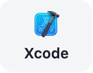
  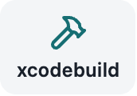
  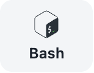
  
  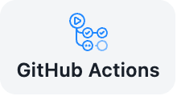
  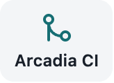
  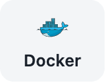
  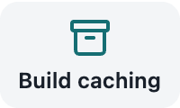

Build automation, reusable tooling and release pipelines.

#### Testing & performance

  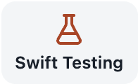
  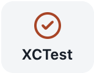
  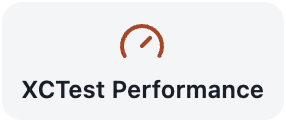
  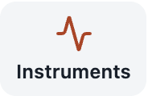
  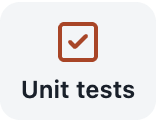
  
  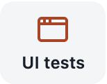
  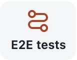

#### AI-assisted development

  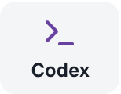
  
  
  
  
  
  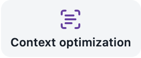
  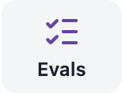
  

Hooks, skills, prompt engineering, automated code review and agents in CI/CD.

#### Languages & frameworks

  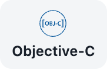
  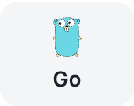
  
  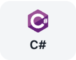
  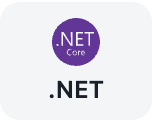
  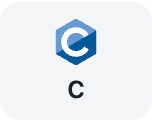
  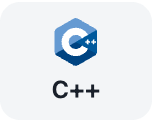
  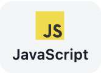
  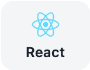
  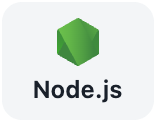
  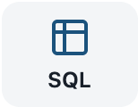

#### Developer tools

  
  
  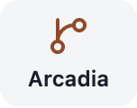
  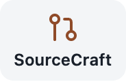
  
  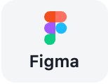
  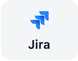

