### Artem Samsonov

iOS Engineer · Apps, SDKs and build tooling

<strong>iOS development</strong> 
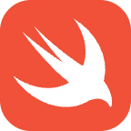&nbsp;Swift&ensp; &nbsp;SwiftUI&ensp; &nbsp;UIKit 
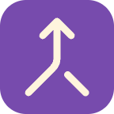&nbsp;Combine&ensp; &nbsp;Accessibility 
&nbsp;MapKit&ensp; &nbsp;Swift&nbsp;Charts&ensp; &nbsp;DivKit

<strong>Concurrency, networking &amp; storage</strong> 
&nbsp;Swift&nbsp;Concurrency&ensp; &nbsp;GCD 
&nbsp;URLSession&ensp; &nbsp;REST&ensp; &nbsp;Core&nbsp;Data 
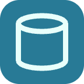&nbsp;SwiftData&ensp; 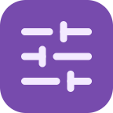&nbsp;UserDefaults 
&nbsp;Keychain&ensp; &nbsp;PostgreSQL

<strong>SDKs &amp; architecture</strong> 
&nbsp;iOS&nbsp;SDKs&ensp; &nbsp;Modularization 
&nbsp;SPM&ensp; &nbsp;CocoaPods&ensp; 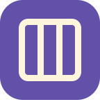&nbsp;MVC 
&nbsp;MVVM&ensp; &nbsp;Clean&nbsp;Swift&nbsp;(VIP) 
&nbsp;VIPER

<strong>Build tooling &amp; CI/CD</strong> 
&nbsp;Xcode&ensp; &nbsp;xcodebuild&ensp; &nbsp;Bash 
&nbsp;fastlane&ensp; &nbsp;GitHub&nbsp;Actions 
&nbsp;Arcadia&nbsp;CI&ensp; &nbsp;Docker 
&nbsp;Build&nbsp;caching

<strong>Testing &amp; performance</strong> 
&nbsp;Swift&nbsp;Testing&ensp; &nbsp;XCTest 
&nbsp;XCTest&nbsp;Performance 
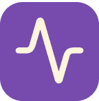&nbsp;Instruments&ensp; &nbsp;Unit&nbsp;tests 
&nbsp;Integration&nbsp;tests&ensp; &nbsp;UI&nbsp;tests 
&nbsp;E2E&nbsp;tests

<strong>AI-assisted development</strong> 
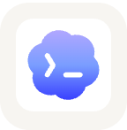&nbsp;Codex&ensp; &nbsp;Claude&nbsp;Code&ensp; &nbsp;Cursor 
&nbsp;MCP&nbsp;servers&ensp; 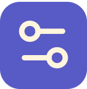&nbsp;Agent&nbsp;harness 
&nbsp;Orchestration 
&nbsp;Context&nbsp;optimization&ensp; &nbsp;Evals 
&nbsp;Agent&nbsp;security

<strong>Languages &amp; frameworks</strong> 
&nbsp;Objective-C&ensp; &nbsp;Go&ensp; 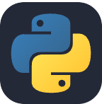&nbsp;Python 
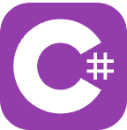&nbsp;C#&ensp; &nbsp;.NET&ensp; &nbsp;C&ensp; 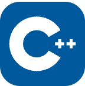&nbsp;C++ 
&nbsp;JavaScript&ensp; 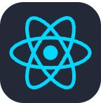&nbsp;React&ensp; &nbsp;Node.js 
&nbsp;SQL

<strong>Developer tools</strong> 
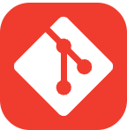&nbsp;Git&ensp; &nbsp;GitHub&ensp; &nbsp;Arcadia 
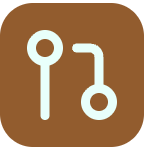&nbsp;SourceCraft&ensp; &nbsp;Firebase&ensp; &nbsp;Figma 
&nbsp;Jira

