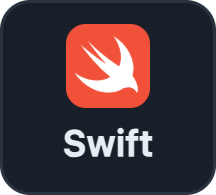

<picture>
  <source media="(max-width: 580px)" srcset="https://raw.githubusercontent.com/Kleshny77/Kleshny77/main/assets/cover/moscow-sunset-mobile.png">
  
</picture>

  
  
  
  
  
  

<strong>More of my stack</strong>

**Languages**

  
  
  
  
  
  
  
  
  
  

**iOS & data**

  
  
  
  

**SDKs & architecture**

  
  
  
  

**Build, testing & performance**

  
  
  
  
  

**AI tools**

  
  
  

