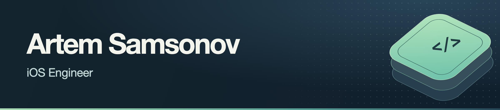

I build iOS apps and Swift SDKs. I’ve worked on chat and calling flows, build tooling and Swift 6 concurrency migrations. I study software engineering at HSE University.

### Selected work

- **[MyFinances](https://github.com/Kleshny77/MyFinances)** — a personal finance app that keeps transactions locally with SwiftData and retries pending changes when the network is back. Its spending chart lives in a separate [Swift package](https://github.com/Kleshny77/Utilities).
- **[cstatiWarehouse](https://github.com/Kleshny77/cstatiWarehouse)** — a SwiftUI client and Go backend for student organizations to track stock across locations, plan inventory rounds and flag items nearing expiry.
- **[AR and machine learning on iOS](https://github.com/Kleshny77/ML_in_iOS_FCS_HSE)** — coursework and experiments, including scenes built with Reality Composer Pro.
